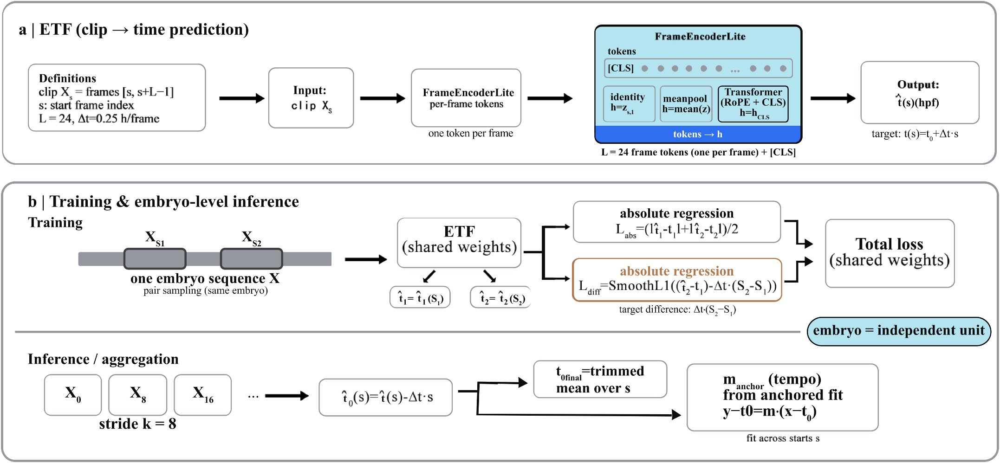

# EmbryoTempoFormer

[](https://doi.org/10.1016/j.ailsci.2026.100170)
[](https://doi.org/10.5281/zenodo.18318139)
[](https://github.com/LijiayuDeng/embryo-tempoformer/actions/workflows/tests.yml)
[](LICENSE)

**English** | [简体中文](README.zh-CN.md)

EmbryoTempoFormer (ETF) measures the developmental tempo of individual zebrafish
embryos from brightfield time-lapse microscopy. A lightweight CNN–Transformer
predicts developmental time from short clips (24 frames, 6 h); the predictions of
each embryo are summarised as an anchored tempo slope `m_anchor` (1 = nominal tempo,
< 1 = slower), and conditions are compared with bootstrap confidence intervals in
which embryos, not frames or clips, are the independent units.

This repository holds the code and the reproduction pipeline of

> Li-Jia-Yu Deng, Pei-Ran Lin, Luo-Tong Xie. **EmbryoTempoFormer: clip-based developmental tempo inference
> from zebrafish brightfield time-lapse microscopy.** *Artificial Intelligence in the Life Sciences* 9, 100170 (2026).
> [doi:10.1016/j.ailsci.2026.100170](https://doi.org/10.1016/j.ailsci.2026.100170)

<p align="center"></p>
<p align="center"><sub>Fig. 1 of the paper (CC BY 4.0). (a) Each frame of a clip is encoded by a CNN and the frame tokens are
aggregated over time to predict developmental time. (b) Training pairs two clips of the same embryo and adds a
temporal-difference consistency loss; at inference, sliding-window predictions are combined into embryo-level
tempo readouts.</sub></p>

## Results

Embryos raised at 25 °C develop about 30 % more slowly than at 28.5 °C (paper Tables 2, 5 and 6, recomputed by
`etf reproduce`):

| Model | RMSE, 28.5 °C test (h) | `m_anchor`, 28.5 °C | `m_anchor`, 25 °C | Δm (25 − 28.5 °C) [95 % CI] |
|---|---:|---:|---:|---|
| `cnn_single`: one frame | 1.513 | 0.984 | 0.751 | −0.233 [−0.245, −0.221] |
| `meanpool`: 24 frames, averaged | 1.165 | 1.002 | 0.743 | −0.259 [−0.273, −0.244] |
| `nocons`: 24 frames, Transformer | 1.119 | 1.014 | 0.722 | −0.292 [−0.304, −0.279] |
| **`full` (ETF): Transformer + consistency loss** | **1.029** | 1.009 | 0.709 | **−0.300 [−0.312, −0.288]** |

Test sets: 22 embryos at 28.5 °C (held out from training) and 95 embryos at 25 °C (not used in training).
RMSE pools correlated sliding windows and is descriptive; `m_anchor` and Δm are embryo-level.

## Installation

```bash
git clone https://github.com/LijiayuDeng/embryo-tempoformer.git
cd embryo-tempoformer
pip install -e .            # Python >= 3.9; provides the `etf` command
```

On a GPU machine, install the CUDA build of PyTorch first ([pytorch.org](https://pytorch.org/get-started/locally/)).
The published numbers were computed with PyTorch 2.5.1 and CUDA 12.4 (exact versions: `requirements-lock.txt`).

## Reproduce the paper

1. Download the reproducibility bundle (processed arrays, splits and the four released checkpoints; 6.5 GB extracted) from
   [Zenodo](https://doi.org/10.5281/zenodo.18318139) and extract it:
   ```bash
   tar -xzf embryo-tempoformer_release_v1_full.tar.gz
   ```
2. Point `etf` to it:
   ```bash
   cp .env.example .env       # then set RELEASE_DIR=/path/to/embryo-tempoformer_release_v1
   ```
3. Run the analysis:
   ```bash
   etf check
   etf reproduce              # equivalent: bash scripts/reproduce_all.sh
   ```

On a laptop GPU (RTX 4060) this takes about 16 minutes. Results go to `runs/paper_eval_<timestamp>/`,
including `paper_tables.md` (Tables 2, 5 and 6) and `figures/` (Figs. 2–4). [docs/reproduction.md](docs/reproduction.md)
lists every step, which output each table and figure comes from, and how to read the readouts.

With Docker instead of a local Python environment:

```bash
docker build -t embryo-tempoformer .
docker run --gpus all -v /path/to/embryo-tempoformer_release_v1:/release:ro -e RELEASE_DIR=/release \
  -v "$PWD/runs:/app/runs" embryo-tempoformer etf reproduce
```

## Use ETF on your own recordings

The released models expect brightfield stacks with one frame every 15 min starting at 4.5 hpf, as in S-BIAD531;
recordings from other microscopes may need low-shot fine-tuning (see the cross-site analysis below). With the
bundle configured as above, two conditions A and B are compared with:

```bash
etf preprocess --in_dir raw/A --proc_dir processed/A --no-pad_to_expect     # one .npy per embryo
etf preprocess --in_dir raw/B --proc_dir processed/B --no-pad_to_expect
etf infer-all --input_dir processed/A --input_dir processed/B --models full --outroot runs/my_study
etf aggregate --outroot runs/my_study --datasets A,B --models full
etf analyze compare --csv_a runs/my_study/A/full/embryo.csv --csv_b runs/my_study/B/full/embryo.csv \
  --label_a A --label_b B --out_dir runs/my_study/compare
```

`embryo.csv` holds `m_anchor` and the residual readouts of every embryo; `compare` writes Δm with its
embryo-bootstrap confidence interval and a power curve (embryos per condition needed to detect the difference).

## Further analyses

| Analysis | Command | Guide |
|---|---|---|
| Cross-site validation and low-shot fine-tuning on Princeton data (Table 7) | `etf sbiad840 ...` | [docs/external-validation.md](docs/external-validation.md) |
| Augmentation ablation (Table 4) | `etf ablation` | [docs/training.md](docs/training.md#augmentation-and-the-ablation-table-4) |
| Training the four models | `etf train --variant ...` | [docs/training.md](docs/training.md) |
| Data bundles, raw data, splits and exclusions | `etf preprocess`, `etf make-split` | [docs/data.md](docs/data.md) |

`etf --help` lists all commands. The scripts as used for the paper are kept in the `v1.1.0` tag;
[CHANGELOG.md](CHANGELOG.md) maps them to the current commands.

## Repository layout

```text
src/etf/      Python package: model, data, training, inference, tempo readouts, statistics, figures, CLI
scripts/      reproduce_all.sh (same as `etf reproduce`)
docs/         guides
tests/        unit tests (CPU only, no data needed): pytest
```

## Citation

```bibtex
@article{deng2026embryotempoformer,
  title   = {EmbryoTempoFormer: clip-based developmental tempo inference from zebrafish brightfield time-lapse microscopy},
  author  = {Deng, Li-Jia-Yu and Lin, Pei-Ran and Xie, Luo-Tong},
  journal = {Artificial Intelligence in the Life Sciences},
  volume  = {9},
  pages   = {100170},
  year    = {2026},
  doi     = {10.1016/j.ailsci.2026.100170}
}
```

## License

Code: MIT ([LICENSE](LICENSE)). Raw recordings: BioImage Archive
[S-BIAD531](https://www.ebi.ac.uk/biostudies/bioimages/studies/S-BIAD531) and
[S-BIAD840](https://www.ebi.ac.uk/biostudies/BioImages/studies/S-BIAD840), under their own terms.
Fig. 1 is reproduced from the paper under CC BY 4.0.
