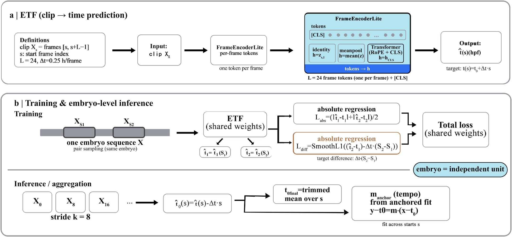

# EmbryoTempoFormer

[](https://doi.org/10.1016/j.ailsci.2026.100170)
[](https://doi.org/10.5281/zenodo.18318139)
[](LICENSE)

[English](README.md) | **简体中文**

EmbryoTempoFormer（ETF）用明场延时显微成像测量单个斑马鱼胚胎的发育速度（tempo）：
- **预测发育时间：** 一个轻量的 CNN–Transformer 从短片段（24 帧，6 小时）预测发育时间。
- **胚胎级 tempo 斜率：** 每个胚胎的所有预测汇总成一个锚定的 tempo 斜率 `m_anchor`（1 = 名义速度，小于 1 = 变慢）。
- **组间比较：** 用 bootstrap 置信区间比较不同条件，统计单位是胚胎，而不是帧或片段。

本仓库是以下论文的代码和完整复现流程：

> Li-Jia-Yu Deng, Pei-Ran Lin, Luo-Tong Xie. **EmbryoTempoFormer: clip-based developmental tempo inference
> from zebrafish brightfield time-lapse microscopy.** *Artificial Intelligence in the Life Sciences* 9, 100170 (2026).
> [doi:10.1016/j.ailsci.2026.100170](https://doi.org/10.1016/j.ailsci.2026.100170)

<p align="center"></p>
<p align="center"><sub>论文 Fig. 1（CC BY 4.0）。(a) 片段中的每帧经 CNN 编码，帧 token 在时间上聚合后预测发育时间。(b) 训练时取同一胚胎的两个片段，
并加入时间差一致性损失；推理时把滑动窗口的预测汇总成胚胎级 tempo 指标。</sub></p>

## 主要结果

25 °C 下胚胎发育比 28.5 °C 慢约 30%。下表数据来自论文 Table 2、5、6，`etf reproduce` 可以重新算出：

| 模型 | 28.5 °C 测试集 RMSE（h） | `m_anchor`，28.5 °C | `m_anchor`，25 °C | Δm（25 − 28.5 °C）[95% CI] |
|---|---:|---:|---:|---|
| `cnn_single`：单帧 | 1.513 | 0.984 | 0.751 | −0.233 [−0.245, −0.221] |
| `meanpool`：24 帧取平均 | 1.165 | 1.002 | 0.743 | −0.259 [−0.273, −0.244] |
| `nocons`：24 帧 + Transformer | 1.119 | 1.014 | 0.722 | −0.292 [−0.304, −0.279] |
| **`full`（ETF）：Transformer + 一致性损失** | **1.029** | 1.009 | 0.709 | **−0.300 [−0.312, −0.288]** |

两个测试集：
- 28.5 °C：22 个胚胎，训练时留出。
- 25 °C：95 个胚胎，训练中从未使用。

RMSE 汇总的是相关的滑动窗口，仅作描述；`m_anchor` 和 Δm 是胚胎级指标。

## 安装

```bash
git clone https://github.com/LijiayuDeng/s-biad531-embryo-tempoformer.git
cd s-biad531-embryo-tempoformer
pip install -e .            # Python >= 3.9，安装后可使用 etf 命令
```

有 GPU 时请先按 [pytorch.org](https://pytorch.org/get-started/locally/) 安装 CUDA 版 PyTorch。论文数字用 PyTorch 2.5.1 和 CUDA 12.4 算出，精确版本见 `requirements-lock.txt`。

## 复现论文

1. 从 [Zenodo](https://doi.org/10.5281/zenodo.18318139) 下载复现数据包（预处理数组、数据划分和 4 个发布的 checkpoint，解压后 6.5 GB）并解压：
   ```bash
   tar -xzf embryo-tempoformer_release_v1_full.tar.gz
   ```
2. 告诉 `etf` 数据包的位置：
   ```bash
   cp .env.example .env       # 然后设置 RELEASE_DIR=/path/to/embryo-tempoformer_release_v1
   ```
3. 运行全部分析：
   ```bash
   etf check
   etf reproduce              # 等同于 bash scripts/reproduce_all.sh
   ```

在笔记本 GPU（RTX 4060）上约需 16 分钟。结果写到 `runs/paper_eval_<时间戳>/`，其中：
- `paper_tables.md`：论文 Table 2、5、6；
- `figures/`：论文 Fig. 2–4。

每一步做什么、每张表和每张图对应哪个输出文件、各指标的含义，见 [docs/reproduction.md](docs/reproduction.md)（英文）。

也可以用 Docker，不需要配置本地 Python 环境：

```bash
docker build -t embryo-tempoformer .
docker run --gpus all -v /path/to/embryo-tempoformer_release_v1:/release:ro -e RELEASE_DIR=/release \
  -v "$PWD/runs:/app/runs" embryo-tempoformer etf reproduce
```

## 用在自己的数据上

发布的模型要求明场图像序列从 4.5 hpf 开始、每 15 分钟一帧（与 S-BIAD531 相同）。其他显微镜采集的数据可能需要少样本微调（见下文的跨站点分析）。按上面配置好数据包后，比较 A、B 两组条件的命令如下：

```bash
etf preprocess --in_dir raw/A --proc_dir processed/A --no-pad_to_expect     # 每个胚胎一个 .npy
etf preprocess --in_dir raw/B --proc_dir processed/B --no-pad_to_expect
etf infer-all --input_dir processed/A --input_dir processed/B --models full --outroot runs/my_study
etf aggregate --outroot runs/my_study --datasets A,B --models full
etf analyze compare --csv_a runs/my_study/A/full/embryo.csv --csv_b runs/my_study/B/full/embryo.csv \
  --label_a A --label_b B --out_dir runs/my_study/compare
```

输出说明：
- `embryo.csv`：每个胚胎的 `m_anchor` 和残差指标。
- `compare`：输出 Δm 及其胚胎 bootstrap 置信区间，以及 power 曲线（检测到这一差异每组需要多少胚胎）。

## 其他分析

| 分析 | 命令 | 说明 |
|---|---|---|
| Princeton 数据的跨站点验证与少样本微调（Table 7） | `etf sbiad840 ...` | [docs/external-validation.md](docs/external-validation.md) |
| 数据增强消融（Table 4） | `etf ablation` | [docs/training.md](docs/training.md#augmentation-and-the-ablation-table-4) |
| 训练四个模型 | `etf train --variant ...` | [docs/training.md](docs/training.md) |
| 数据包、原始数据、数据划分与排除规则 | `etf preprocess`、`etf make-split` | [docs/data.md](docs/data.md) |

`etf --help` 列出全部命令。论文所用的原版脚本保存在 `v1.1.0` 标签中，新旧命令的对应关系见 [CHANGELOG.md](CHANGELOG.md)。

## 引用

```bibtex
@article{deng2026embryotempoformer,
  title   = {EmbryoTempoFormer: clip-based developmental tempo inference from zebrafish brightfield time-lapse microscopy},
  author  = {Deng, Li-Jia-Yu and Lin, Pei-Ran and Xie, Luo-Tong},
  journal = {Artificial Intelligence in the Life Sciences},
  volume  = {9},
  pages   = {100170},
  year    = {2026},
  doi     = {10.1016/j.ailsci.2026.100170}
}
```

## 许可证

- 代码：MIT（[LICENSE](LICENSE)）。
- 原始数据：BioImage Archive [S-BIAD531](https://www.ebi.ac.uk/biostudies/bioimages/studies/S-BIAD531) 和 [S-BIAD840](https://www.ebi.ac.uk/biostudies/BioImages/studies/S-BIAD840)，遵循各自的条款。
- Fig. 1 依 CC BY 4.0 转载自论文。
